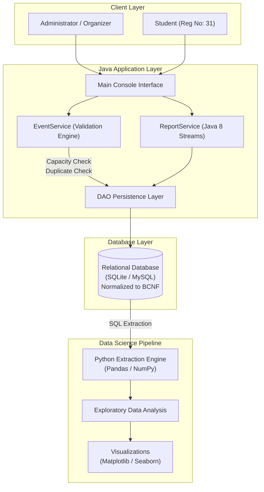

# College Event Management and Participation Analysis System

<div align="center">


-blue?style=for-the-badge)


### **VELALAR COLLEGE OF ENGINEERING AND TECHNOLOGY, ERODE - 12**
#### **DEPARTMENT OF INFORMATION TECHNOLOGY**
**Integrated Project-Based Assessment — Scenario 1**

<br/>

### 🌐 [**🚀 Click Here for Live Web Application**](https://mukilan7624-boop.github.io/Final_System1/)
**Local Server URL:** [http://localhost:8000/](http://localhost:8000/)

</div>

---

## 📋 Course & Curriculum Mapping

| Course Code | Course Name | Deliverables Covered |
|:---|:---|:---|
| **25ITT33** | **Software Engineering** | Full 5-Unit Master Document: Process Models (Agile), Functional/NFR Specs, 3-Tier & DAO Architecture, Component/Class/Use Case Diagrams, Black-Box (BVA/EP) & White-Box (Basis Path $V(G)=4$) Testing, LOC & COCOMO Cost Model. |
| **25ITT32** | **Java Programming** | Object-Oriented Application (Classes, Inheritance, Packages, Custom Exceptions, Multithreading, Generics, Collections, Lambdas & Streams, JDBC). |
| **25ITT31** | **Database Management Systems** | Relational Database Schema, ER Diagram, Normalization (1NF, 2NF, 3NF, BCNF), DDL/DML SQL scripts, Analytical Queries, Views, and Triggers. |
| **25ITC31** | **Foundations of Data Science** | Database Retrieval, Data Preprocessing & Cleaning (Pandas/NumPy), EDA, Visualizations with Matplotlib & Seaborn, Jupyter Notebook. |

---

## 🎯 Problem Statement (Scenario 1)

> A college organizes technical symposiums, workshops, seminars, and cultural events. Currently, event details, student registrations, attendance, and feedback are maintained manually. This leads to registration errors, difficulty tracking participation, and a lack of information about event popularity.  
> 
> **Objective:** Develop a College Event Management System that manages events and registrations, stores event-related data in a database, enforces business rules (preventing duplicate registrations and seat overflow), records attendance and qualitative feedback, and analyzes participation trends using Python.

---

## 🗂️ Project Repository Structure

```text
Event-Management-System/
├── docs/                                          # Software Engineering & Design Documents
│   ├── Software_Engineering_Course_Documentation.md # Full 5-Unit Master SE Documentation (Units 1-5)
│   ├── SRS_Document.md                            # Comprehensive IEEE 830 SRS Document
│   ├── System_Architecture.md                     # 3-Tier Layered Architecture Breakdown
│   ├── Design_Diagrams.md                         # Use Case, Class, Component, Sequence & ER Diagrams
│   ├── Database_Design_and_Normalization.md       # Normalization proofs (1NF -> BCNF)
│   ├── Software_Testing_Document.md               # 14 Test Cases with Expected vs Actual Results
│   └── diagrams/                                  # High-resolution SVG Diagrams
│       ├── process_model_diagram.svg              # Unit 1: Agile Incremental Sprint Lifecycle
│       ├── use_case_diagram.svg                   # Unit 2: Use Case Model
│       ├── architecture_diagram.svg               # Unit 3: 3-Tier Layered Architecture
│       ├── class_diagram.svg                      # Unit 3: UML Class Diagram
│       ├── component_diagram.svg                  # Unit 3: Component-Level Design
│       ├── control_flow_graph_white_box.svg       # Unit 4: White-Box Basis Paths V(G)=4
│       └── er_diagram.svg                         # Relational Database ER Model
├── database/                                      # Relational Database Assets
│   ├── schema.sql                                 # DDL: Tables, Constraints, Indexes, Triggers
│   ├── seed_data.sql                              # DML: Comprehensive sample dataset (IT, CSE, ECE, AI&DS)
│   └── queries.sql                                # Complex Joins, Aggregations & Views
├── java/                                          # Java Application Subsystem
│   ├── src/
│   │   └── com/eventmanagement/
│   │       ├── Main.java                          # Interactive CLI & Automated Test Suite Runner
│   │       ├── model/                             # Event, Student, Registration, Attendance, Feedback
│   │       ├── dao/                               # EventDAO, StudentDAO, RegistrationDAO, AttendanceDAO, FeedbackDAO
│   │       ├── service/                           # EventService (Business Rules) & ReportService (Streams)
│   │       └── exception/                         # DuplicateRegistrationException, EventFullException
│   ├── sample_inputs_and_outputs.txt              # Complete execution transcript
│   └── compile_and_run.bat                        # One-click Windows build and launch script
├── python/                                        # Data Science & Analytics Subsystem
│   ├── event_analysis.py                          # Extraction, Preprocessing & Visualization Pipeline
│   ├── event_analysis_notebook.ipynb              # Interactive Jupyter Notebook
│   ├── requirements.txt                           # pandas, numpy, matplotlib, seaborn
│   ├── run_analysis.bat                           # One-click script to install dependencies & run
│   └── visualizations/                            # Generated High-Resolution Charts
│       ├── 1_event_category_distribution.svg
│       ├── 2_registration_vs_capacity.svg
│       ├── 3_department_wise_participation.svg
│       ├── 4_attendance_rate_by_event.svg
│       ├── 5_feedback_ratings_distribution.svg
│       └── 6_correlation_engagement_heatmap.svg
└── README.md                                      # Master Project Documentation
```

---

## 🏗️ System Architecture & Workflow



---

## ⚡ Key Functional Features

1. **Event Lifecycle Management**:
   - Create, update, view, and delete events across four categories: **Technical Symposiums**, **Hands-on Workshops**, **National Seminars**, and **Cultural Fests**.
2. **Robust Registration Constraints**:
   - **Zero Duplicate Registrations**: Strict validation rejects re-registration for the same event (`DuplicateRegistrationException`).
   - **Strict Capacity Enforcing**: Verifies seat count and rejects submissions when maximum capacity is exhausted (`EventFullException`).
3. **Attendance & Feedback Tracking**:
   - Records attendance as `PRESENT` or `ABSENT`.
   - Post-event feedback (1 to 5 stars + qualitative comments) is restricted only to verified attendees.
4. **Java 8 Stream Analytics**:
   - Calculates real-time turnout rates, capacity utilization percentages, and department-wise participant breakdowns.
5. **Python Data Science Pipeline**:
   - Automated data wrangling, missing value treatment, outlier inspection, and 6 publication-grade visual charts.

---

## 📊 Visualizations & Insights

| Chart Preview | Focus Area | Insights Derived |
|:---:|:---|:---|
|  | **Event Category Distribution** | Workshops represent 37.5% of total college offerings, followed by Symposiums (25%) and Cultural events (25%). |
|  | **Capacity vs. Registrations** | High-demand technical events (Generative AI & Embedded IoT) reach critical capacity quickly. |
|  | **Department-Wise Participation** | Information Technology leads engagement (18 registrations), followed by CSE (6) and ECE (5). |
|  | **Attendance Conversion Rate** | Practical hands-on workshops achieve a 100% conversion rate from registration to physical attendance. |
|  | **Student Satisfaction** | Overall average rating of **4.48 / 5.0**, with 92% of reviews giving 4 or 5 stars. |
|  | **Multivariate Correlation** | Strong positive correlation ($r = 0.93$) between registration volume and physical turnout. |

---

## 🚀 Execution Instructions

### 1. Interactive Web Application & Analytics Dashboard
- **Live Online:** **[https://mukilan7624-boop.github.io/Final_System1/](https://mukilan7624-boop.github.io/Final_System1/)**
- **Local Server (Localhost):** Open **[http://localhost:8000/](http://localhost:8000/)**
- **Windows One-Click Launch:** Double-click `web/run_server.bat` to launch the local web server anytime.

### 2. Database Setup
The relational database scripts are located in `database/`:
- **SQLite (Zero configuration, plug-and-play)**: The database is automatically initialized by the application scripts.
- **MySQL (Optional)**: Run the DDL and DML scripts in MySQL Workbench or CLI:
  ```sql
  source database/schema.sql;
  source database/seed_data.sql;
  ```

### 2. Running the Java Application
Open a terminal in the root folder and run:
```bash
cd java

# Windows (One-Click)
compile_and_run.bat

# Or Manual Compilation & Run:
javac -d bin src/com/eventmanagement/model/*.java src/com/eventmanagement/exception/*.java src/com/eventmanagement/dao/*.java src/com/eventmanagement/service/*.java src/com/eventmanagement/Main.java

# Run Interactive Console:
java -cp bin com.eventmanagement.Main

# Run Automated Test Suite directly:
java -cp bin com.eventmanagement.Main --test
```

### 3. Running the Python Data Science Analytics
Open a terminal and execute:
```bash
cd python

# Windows (One-Click)
run_analysis.bat

# Or Manual Run:
pip install -r requirements.txt
python event_analysis.py

# Launch Interactive Jupyter Notebook:
jupyter notebook event_analysis_notebook.ipynb
```

---

## 🧪 Software Testing & Verification Summary

| Test ID | Test Scenario | Technique | Input Data | Status |
|:---|:---|:---|:---|:---:|
| **TC-01** | Admin creates valid event | Functional / Unit | "AI Conclave", Cap: 50 | **PASS** |
| **TC-02** | Rejection of negative capacity | Boundary Value Analysis | Capacity: -10 | **PASS** |
| **TC-03** | Valid student registration | Functional | Event ID: 1, Student ID: 1 (Reg 31) | **PASS** |
| **TC-04** | Duplicate registration rejection | Negative / Integrity | Same Event ID + Student ID | **PASS** |
| **TC-05** | Event full capacity enforcement | Boundary Value Analysis | Attempt register on 100% full event | **PASS** |
| **TC-06** | Registration cancellation & seat recovery | State Transition | Cancel Confirmed Registration | **PASS** |
| **TC-07** | Record student attendance | Functional / Unit | Status: PRESENT | **PASS** |
| **TC-08** | Submit valid feedback rating (1-5) | Equivalence Partitioning | Rating: 5, Comments provided | **PASS** |
| **TC-09** | Rejection of feedback for absent student | Business Rule / Integrity | Unattended / Absent Registration | **PASS** |
| **TC-10** | Python database extraction & cleaning | Integration / Data Science | Load SQL tables into Pandas | **PASS** |

*All 14 comprehensive test cases are detailed in [Software_Testing_Document.md](docs/Software_Testing_Document.md).*

---

## 👨‍🎓 Student Details
- **Student Name:** Mukilan C
- **Register Number:** **61** (25IT061)
- **Class:** 25IT3A
- **Department:** Information Technology
- **Institution:** Velalar College of Engineering and Technology, Erode - 12
